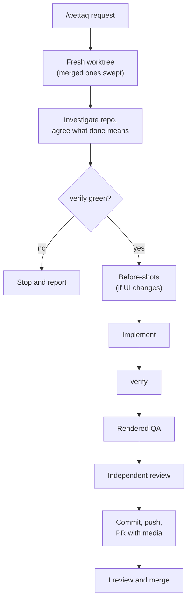

# coding-agent-config

This is the configuration I use to make coding agents more reliable across my projects.

## The case

Coding agents are very capable, but handing one a task and hoping for the best is still pretty hit or miss. One run is careful; the next skips the tests, never looks at the UI and hands me a PR I have to reverse-engineer.

I don't think the fix is writing the perfect prompt every time. **The fix is a workflow around the agent** that does the heavy lifting:

* the repository, not my prompt, is the source of truth;
* deterministic gates the agent can't talk its way past;
* actually looking at the rendered UI, including how it moves;
* an independent reviewer for changes where judgement matters; and
* a pull request I can review in a minute.

The agent gets to do the work. **Product decisions and merges stay with me.**

## What you get

* An isolated worktree per task, swept away automatically on a later run once its PR is merged.
* A green `npm run verify` before work starts and again before delivery.
* Rendered QA across desktop, tablet and mobile, including animations, reduced motion, keyboard use and console errors.
* PRs with before/after screenshots, GIFs for motion, the tests that protect the behaviour, and a call on how dangerous the merge is.
* One configuration shared by [OpenCode](https://opencode.ai/), [Claude Code](https://code.claude.com/), and [Codex CLI](https://developers.openai.com/codex/cli).

## The flow



Not every change needs every step. A one-line fix doesn't get an independent review; a substantial feature does. The workflow is deliberately proportional.

## What's in the box

| | Name | What it does |
| --- | --- | --- |
| Command | [`/wettaq`](commands/wettaq.md) | Takes a request from investigation to a reviewable PR |
| Command | [`/ittestja`](commands/ittestja.md) | Hands-on rendered QA of a route, flow, PR or session; reports, never edits |
| Command | [`/sewwi`](commands/sewwi.md) | Audits or changes this configuration coherently |
| Command | [`/fassal`](commands/fassal.md) | Writes or refines a product's `UX_PRINCIPLES.md` |
| Agent | [`code-reviewer`](agent/code-reviewer.md) | Independent review via OCR delegation, plus the merge-danger call |
| Agent | [`ui-designer`](agent/ui-designer.md) | Designs and implements UI grounded in the repo |
| Skill | [`rendered-qa`](skills/rendered-qa/SKILL.md) | How to exercise a running UI and capture evidence |
| Skill | [`commit-pr-writing`](skills/commit-pr-writing/SKILL.md) | Commit messages and PR descriptions that prove their claims |
| Skill | [`repo-context`](skills/repo-context/SKILL.md) | Evidence-based map of an unfamiliar repository |
| Skill | [`ui-designer`](skills/ui-designer/SKILL.md) | Practical UI judgement: hierarchy, layout, forms, accessibility |
| Skill | [`frontend-design`](skills/frontend-design/SKILL.md) | Aesthetic direction for new or reshaped UI |
| Skill | [`ux-principles`](skills/ux-principles/SKILL.md) | Product-level UX principles discovery |
| Skill | [`angular`](skills/angular/SKILL.md) | Angular architecture, forms, state and testing guidance |
| Skill | [`playwright-tests`](skills/playwright-tests/SKILL.md) | Resilient Playwright UI tests |
| Skill | [`skill-creator`](skills/skill-creator/SKILL.md) | Creating and evaluating skills |
| Skill | [`workflow-for-alex`](skills/workflow-for-alex/SKILL.md) | Governance for changing this workflow |
| Skill | [`verifika`](https://github.com/alexportelli12/verifika/blob/main/skills/verifika/SKILL.md) | Running and diagnosing Verifika checks; linked from the pinned npm package |
| Script | [`ibni`](scripts/ibni/ibni.mjs) | Worktree lifecycle: prepare, publish, PR media, adopt, timings, cleanup |
| Script | [`install.mjs`](scripts/install.mjs) | Links shared configuration into all three hosts |
| Hook | [`guard.mjs`](scripts/hooks/guard.mjs) | Refuses force pushes, pushes to the default branch, merges, destructive Git outside an owned worktree, `guard.deny` commands and Shopify Admin API writes, on every host |
| Hook | [`loop-breaker.mjs`](scripts/hooks/loop-breaker.mjs) | Tells the agent to stop and re-diagnose when the same command fails a third time |
| Mod | [`run-pane`](claude/mods/run-pane) | Claude Code only: a pane with the current run's stage, gates, worktree, port and PR, and a band suggesting a fresh session once the PR is out or context runs high |
| Mod | [`command-fixer`](claude/mods/command-fixer) | Claude Code only: quotes `--include=*` globs, adds `pipefail` to verify pipes, backgrounds a full verify |

The previous names (`/implement`, `/qa`, `/update-my-workflow`, `/ux.principles`, Codex's `$workflow-…` wrappers and `implementation-workspace`) still work for one release, as thin aliases of the new ones.

[`AGENTS.md`](AGENTS.md) holds the cross-project engineering principles, including when agents may branch, commit and open PRs. `opencode/opencode.json`, `claude/agents.json`, and `codex/agents.json` are templates for the host-specific bits; the installer renders them, with the agent definitions from `agent/` and Codex's explicit-invocation skill wrappers from `commands/`, using your `config.json`.

## Getting started

**Prerequisites:** Node.js, the [`gh`](https://cli.github.com/) CLI (signed in), the [`ocr`](https://github.com/alibaba/open-code-review) CLI for reviews, the [Playwright MCP](https://github.com/microsoft/playwright-mcp) server in your host for rendered QA, and `ffmpeg` if you want GIFs.

Put `~/.local/bin` on your `PATH`, then clone this repo to `~/workspace/mexxi` and install from `main`:

```bash
git clone https://github.com/alexportelli12/coding-agent-config.git ~/workspace/mexxi
cd ~/workspace/mexxi
npm ci
node scripts/install.mjs
node scripts/install.mjs --check
```

**Configuration lives in one file:** `~/.config/mexxi/config.json` (or the file `MEXXI_CONFIG` names). The first install writes a minimal one; every key is optional and falls back to the default in [`config.schema.json`](config.schema.json), which also describes it. [`config.example.json`](config.example.json) spells out every key: the clone's location, the worktree root (`~/.local/share/mexxi/worktrees`), which hosts to install for, the model per agent and host, and the branch prefix. Change that file, never a tracked one, then run `node scripts/install.mjs` again. To clone somewhere else, write `{"paths": {"checkout": "<your clone>"}}` to `config.json` first; the installer refuses to run from any clone but the one it names.

The installer renders the host files from `config.json` into `~/.local/share/mexxi/generated/`, then links them and the shared files into `~/.config/opencode/`, `~/.claude/`, and Codex's home (`~/.codex/`, or `CODEX_HOME` when set). Codex gets the shared `AGENTS.md` at its config root and rendered TOML agents in `agents/`. Shared skills, Verifika's skill from `node_modules`, and rendered command wrappers are linked individually into `~/.agents/skills/`, Codex's user skill discovery location; this stays under your home even with a custom `CODEX_HOME`. The installer puts `ibni` in `~/.local/bin`, removes the retired `verify-runner` link it used to install, and adds a `post-merge` hook so a later `git pull` on `main` reinstalls automatically. It never overwrites existing configuration; on a conflict it stops and lists the paths. Your personal Codex `config.toml` is preserved, and agents without a model in `config.json` inherit the host's. The Codex reviewer defaults to a read-only sandbox; Codex's parent runtime permission overrides still take precedence.

Claude Code's `CLAUDE.md` is rendered too: the shared `AGENTS.md` followed by [`claude/overlay.md`](claude/overlay.md), the few rules only Claude Code's tools need. Codex and OpenCode read `AGENTS.md` as it is.

`install --check` renders again and fails on any difference, so a hand-edited host file or a stale render shows up as a red check. Moving from an older checkout (for example the clone that used to live in `~/.config/opencode`)? Pass the path its links point at, `node scripts/install.mjs --migrate-from ~/.config/opencode`, and the installer relinks them to the new clone instead of stopping on them as conflicts.

**Playwright MCP** for rendered QA is pinned and configured from `config.json`'s `browser` group (version, browser executable, output directory; the output directory defaults to the worktree root, so screenshots can be written straight into a workspace's evidence directory). OpenCode gets it rendered into its `opencode.json`. Claude Code and Codex keep MCP servers in files that are yours, so the installer prints the exact registration lines and never runs them:

```bash
claude mcp add --scope user playwright -- npx -y @playwright/mcp@0.0.83 --headless --isolated --executable-path=/usr/bin/chromium --output-dir=<worktree root>
codex mcp add playwright -- npx -y @playwright/mcp@0.0.83 --headless --isolated --executable-path=/usr/bin/chromium --output-dir=<worktree root>
```

`install --check` reads `~/.claude.json` and `~/.codex/config.toml` back and fails when an enabled host has no Playwright server registered, or one with another version or output directory (or `--allow-unrestricted-file-access`, which would let the browser open any `file://` path). To change the pin, edit `config.json`, run the installer, then `claude mcp remove --scope user playwright` / `codex mcp remove playwright` and register again with the new lines.

**Claude Code's `settings.json`** stays yours. The installer merges only `permissions.deny` (one `Bash(<prefix>:*)` rule per entry of `guard.deny`, the production deploy and merge commands), `env.BASH_MAX_TIMEOUT_MS` (`claude.bashMaxTimeoutMs`, 15 minutes by default) and the hook entries that run the guard and the loop breaker, and records what it added in `~/.local/share/mexxi/state/`. Changing `config.json` later removes only those entries, your own rules and keys are untouched, a value you set for the timeout yourself is reported as a conflict rather than overwritten, and `install --check` fails if an owned entry is missing.

**One guard, three hosts.** Claude Code and Codex run [`scripts/hooks/guard.mjs`](scripts/hooks/guard.mjs) before every shell command and [`loop-breaker.mjs`](scripts/hooks/loop-breaker.mjs) after it; OpenCode runs the same code through [`opencode/plugins/mexxi-guard.js`](opencode/plugins/mexxi-guard.js), which the rendered `opencode.json` loads. Codex's entries are merged into its `hooks.json` the same way, beside any hooks of your own, and Codex skips new hooks until you trust them once: start `codex` and approve them in `/hooks`. A refused command reaches the agent as the tool's error with the reason. Prefix deny rules alone are sidestepped by `cd x && <command>`; the guard reads every command in the line, including `bash -c` scripts and `$(...)`, but treats quoted text as data, so `echo "git push --force"` runs. `guard.blockUnquotedGlobs` also refuses unquoted `--include=*` globs; turn it on only if a fresh Claude Code session shows `grep -rn x --include=*.ts .` failing with "no matches found".

**Claude Code mods** ship in [`claude/mods/`](claude/mods), listed by [`.claude-plugin/marketplace.json`](.claude-plugin/marketplace.json). Where the `claude` CLI is installed, the installer adds this clone as a folder marketplace and installs the mods `config.json`'s `mods` names (`claude plugin marketplace add`, `claude plugin install <mod>@mexxi`), skipping any already installed. Claude Code reads them from the clone itself, so a `git pull` updates them; open sessions pick changes up with `/reload-plugins`. `install --check` asks `claude plugin list` where each is read from. Open the run pane with `/run-pane`; it also opens on its own once a session runs `ibni prepare` or `adopt`.

Start a new Codex session after installation. A non-empty `AGENTS.override.md` in Codex's home takes precedence over the installed `AGENTS.md`; remove your override when you want the shared guidance. Invoke command wrappers explicitly as `$mexxi-wettaq <request>`, `$mexxi-ittestja <request>`, `$mexxi-sewwi <request>`, or `$mexxi-fassal <request>`. These use the canonical command bodies with the invocation's request as their arguments; ordinary skills retain their existing names. Codex discovers skills through `/skills` or `$` and agents from its `agents/` directory. Unlike OpenCode and Claude's slash commands, these wrappers use Codex's native skill invocation.

**An app repo needs one thing:** an `npm run verify` script that defines "mechanically healthy" for that project (lint, types, tests, whatever fits). Nothing host-specific. The recommended way is [Verifika](https://github.com/alexportelli12/verifika): list the checks in `verifika.config.json` and set `"verify": "verifika --all"`, as this repo does. Agents can then run only the checks a change affects while they work, and read compact failures and per-check logs.

**A first command to try**, from the app repo's default branch:

```text
/wettaq show the last sync time on the settings page
```

For occasional manual use:

```bash
ibni --help                   # every command; ibni <command> --help for its flags
ibni list                     # retained workspaces
ibni info --session <id>      # paths, branch, port and PR for one
ibni stats --session <id>     # step timings, verify attempts, finding counts
ibni adopt --pr <url>         # take over an open PR's workspace in a new session
ibni cleanup                  # what would be removed (dry run)
ibni cleanup --dry-run false  # remove merged, consumed ones
```

You rarely need the last two: every `/wettaq` sweeps merged workspaces on the way in.

## Principles

* **Repository first.** The app repo owns its architecture and conventions; this config sits above it.
* **Deterministic before prose.** If a tool can check it, don't rely on an agent remembering an instruction.
* **Proportional process.** Ceremony scales with the change.
* **The human owns merges.** Agents can prove, review and propose. They don't decide what ships.

The full reasoning lives in [`workflow-for-alex`](skills/workflow-for-alex/SKILL.md).

## Using it yourself

Go for it. This repo is public because I wanted to share the workflow I've been building while using coding agents day to day.

It's opinionated around how **I** like to work, so I wouldn't copy the whole thing and expect it to fit. Browse it, take the bits that fit, and change the bits that don't.

If it gives you one useful idea for your own setup, it has done its job.
