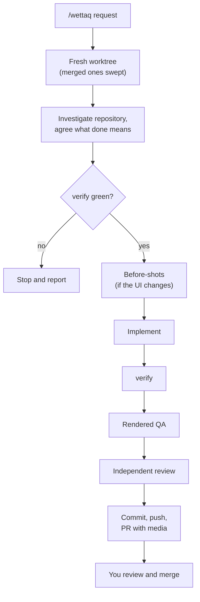

---
sources:
  - commands/wettaq.md
  - skills/implement-review/SKILL.md
  - skills/rendered-qa/SKILL.md
  - scripts/ibni/commands/**
reviewed: 2026-10-21
---

# How a run works

`/wettaq` takes one request to a pull request you can review in a minute. It works in a fresh worktree, proves the change with deterministic checks, looks at the rendered result, and asks an independent reviewer when judgement matters.

Not every change needs every step. A one-line fix skips the independent review; a substantial feature gets it. The workflow is proportional on purpose.

## The stages

1. **A fresh worktree.** `ibni prepare` creates a locked worktree and branch for the task, picks a free port, and sweeps worktrees whose pull requests have merged. Every later command runs there, never in your checkout.
2. **A task contract.** The agent reads the repository, its closest analogues and its tests, then writes down what done means. It asks you only about product decisions it cannot infer.
3. **A green baseline.** `npm run verify` must pass before work starts. If CI has already proven the base commit, the agent cites that run instead.
4. **Before-shots.** When the change alters existing UI, the agent captures it first, so reviewers see before and after.
5. **Implementation.** The agent changes the code and adds proof at the cheapest level that proves the behaviour.
6. **Final verification.** `npm run verify` runs again. It is the one authoritative gate, and a failure means the work is unfinished.
7. **Rendered QA.** For user-facing work, the agent drives the running UI at three viewports and checks motion, keyboard use, touch targets and console errors. See [rendered-qa](../skills/rendered-qa/SKILL.md).
8. **Independent review.** The [code-reviewer](../agent/code-reviewer.md) judges the change in a read-only sandbox. See [implement-review](../skills/implement-review/SKILL.md).
9. **Delivery.** `ibni record-evidence` and `ibni publish` push the branch without force. The agent opens the pull request, with screenshots and a call on how risky the merge is.

You review the pull request and decide whether to merge. Mexxi never merges for you.

## What stops an agent talking its way past a gate

The delivery gate is code: `ibni publish` refuses a branch without recorded evidence that the committed tree passed. The loop breaker tells an agent to stop and re-diagnose when the same command fails a third time. See [the CLI reference](cli/index.md) for each step.

The red lines are rules: the agent never merges, force pushes or pushes to the default branch. The guard hook is a backup for some of them, not a substitute. A command it lets through is not thereby allowed.

## After the pull request

The worktree stays for follow-up changes, in the same session or a later one through `ibni adopt`. [`/irrifletti`](../commands/irrifletti.md) measures how recent sessions went, privately, so you can see whether a change to the workflow helped.
