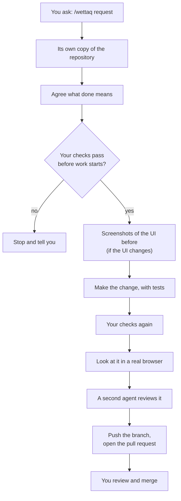

---
sources:
  - commands/wettaq.md
  - skills/implement-review/SKILL.md
  - skills/rendered-qa/SKILL.md
  - scripts/ibni/commands/**
reviewed: 2026-10-22
---

# How a run works

A run is what happens between typing [`/wettaq`](../commands/wettaq.md), the command that builds a change, and a pull request you can review in about a minute. Each step exists so that the pull request arrives with its proof, and you never have to take the agent's word for anything.

Not every change needs every step. A one-line fix skips the independent review; a substantial feature gets it. A change without a UI skips the browser. The workflow is proportional on purpose, so small changes stay fast.

## The steps

1. **Its own copy of the repository.** `ibni prepare`, from [`ibni`](cli/index.md), the command-line tool the agent runs, creates a [worktree](glossary.md#worktree) and branch for the task, so your checkout stays untouched. It picks a free port, so two tasks can run their development servers at once. It also sweeps away worktrees whose pull requests have merged.
2. **Agree what done means.** The agent reads the repository, its closest examples and its tests, then writes down what done means before any code exists, so the target is settled first. It asks you only about product decisions it cannot work out from the code.
3. **Start from green.** The repository's [verify command](glossary.md#verify) (`npm run verify` unless its `.mexxi.json` names another) must pass before work starts. Otherwise a failure at the end could be an old one, blamed on the change. If CI has already proven the starting commit, the agent cites that run instead.
4. **Screenshots before.** When the change alters existing UI, the agent captures it first, so the pull request can show before and after.
5. **Make the change, with tests.** The agent changes the code and adds proof at the cheapest level that proves the behaviour. A date-formatting rule gets a unit test, not a browser test; a browser test is for a flow that crosses pages or services.
6. **Your checks again.** The verify command runs again on the final code. It is the one authoritative gate, and a failure means the work is unfinished.
7. **Look at it in a real browser.** For user-facing work, the agent drives the running app at phone, tablet and desktop sizes and checks motion, keyboard use, touch targets and console errors. This is [rendered QA](glossary.md#rendered-qa); see [rendered-qa](../skills/rendered-qa/SKILL.md). [`/ittestja`](../commands/ittestja.md) runs the same check on its own, without changing code.
8. **A second agent reviews it.** For substantial changes, the [code-reviewer](../agent/code-reviewer.md) judges the change. It cannot edit code, so it only reports, and the builder fixes what it finds. See [implement-review](../skills/implement-review/SKILL.md).
9. **Push and open the pull request.** The agent runs `ibni record-evidence` to record the exact code its checks passed on. `ibni publish` then pushes the branch, never by force, and only if that code has not changed since. The agent opens the pull request, with screenshots and a [merge call](glossary.md#merge-call).

You review the pull request and decide whether to merge; [Reviewing a mexxi pull request](reviewing-a-pull-request.md) says what to check. mexxi never merges for you.

## What stops an agent talking its way past a step

Part of the delivery step is code: `ibni publish` refuses to push code other than what the agent recorded as passing. Running the checks before recording them is a rule the agent follows, and the pull request's evidence shows the result. The [loop breaker](glossary.md#loop-breaker) tells an agent to stop and re-diagnose when the same command fails a third time. [The CLI reference](cli/index.md#the-agent-s-lifecycle) shows the order in which the agent runs `ibni`, and why each step exists.

The red lines are rules: the agent never merges, force pushes or pushes to the default branch. The [guard](glossary.md#guard) hook is a backup for some of them, not a substitute. A command it lets through is not thereby allowed.

## After the pull request

The worktree stays for follow-up changes. Ask `/wettaq` again with the pull request's link, in the same session or a later one, and it updates the same pull request. [`/irrifletti`](../commands/irrifletti.md), which looks back at recent sessions, measures how they went, privately. It shows whether a change to the workflow helped.
