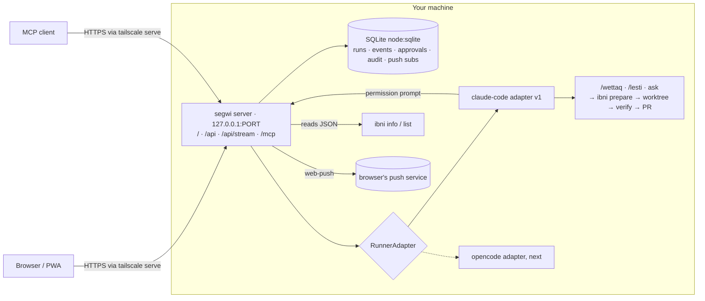

# Plan: segwi

This is the working plan for segwi, an opt-in mexxi feature. It lives here only while segwi is built and is deleted when the install and docs phase lands; [decision 0011](../decisions/0011-segwi.md) and the user guide remain.

**Why segwi exists.** A mexxi run takes minutes to an hour, and it stops when it needs a reply or a permission. Today you have to be at the terminal for that. segwi lets you start, follow, answer and stop a run from your phone or from any MCP client. It runs on a machine you own and keeps every mexxi rule.

**Status.** Proposed. Sections 0 to 12 are the specification. The spike in phase 1 replaces the "Spike results" section below with what it finds, and corrects any section the findings contradict.

## Spike results

Pending. The spike fills in:

- the confirmed Claude Code flags and their documentation links;
- which permission mode sends calls outside the allow list to `--permission-prompt-tool`, or proof that the fallback is needed;
- the allow list derived from at least 20 real `/wettaq` and `/lesti` transcripts, with counts per tool call;
- the current `npm run verify` time on the host;
- the Maltese words for the interface, each verified against dizzjunarju.mt, then Ġabra.

## 0. What mexxi already gives us (read-only findings)

| Area | mexxi today | Consequence for segwi |
|---|---|---|
| Purpose | Leads Claude Code, Codex or OpenCode from a request to a PR that passes the repository's verify command. Never merges. | segwi is a **launcher and viewer for mexxi runs**, not a second workflow. |
| Hosts | One shared workflow, thin host adapters (ADR 0001). | Runners are host adapters: host mechanics only, never rules. |
| Config | One user file, `~/.config/mexxi/config.json`, against `config.schema.json`. A personal value in a tracked file is a defect (ADR 0002). | New optional `segwi` key, off by default. |
| Installer | Owns only what it records; `--dry-run`; turning a feature off removes what it added (ADR 0003). | The CLI link and the optional systemd user unit are recorded and rolled back. |
| Worktrees | `ibni` owns git: prepare, record, publish, mark-pr, adopt, cleanup. Prints JSON, fails closed (ADR 0004). | segwi never creates worktrees or pushes. Branch, PR and verify result come from `ibni info` / `ibni list`. |
| Safety | AGENTS.md rules backed by the guard hook, the deny list and branch protection (ADR 0006). Redaction in `scripts/lib/redact.mjs`. | Headless runs load mexxi's user hooks; never `disableAllHooks`. Everything stored or returned goes through `redact()`. |
| Verify | `npm run verify` = `verifika --all` (ADR 0010). | Add verifika checks `segwi` and `segwi-web`, within a time budget (§9). |
| Docs | Generated from tracked files; names in `names.json` (ADR 0009). | One page, `docs/segwi.md`, plus ADR 0011, a names.json entry and a glossary entry. Not on the landing page in the MVP. |
| Stack | Node ≥ 22.13, plain ESM, no runtime dependencies. | Server adds only `@modelcontextprotocol/sdk`, `zod` and `web-push`. |
| Look | `site/styles.css` and the VitePress `custom.css` duplicate the palette as hex. | Extract `site/tokens.css` once; all three consumers read it (§7). |
| Licence | None. | MIT before anything else. |

## 1. Goal and non-goals

**Goal.** Start, follow, answer and stop headless mexxi runs on your own machine, from a mobile-first web app (an installable PWA with push notifications) and from any MCP client. One local process, one SQLite database. Every run ends as a normal mexxi PR. SSH stays the break-glass route.

**The MVP is done when** you can do all of this from your phone. Start `/wettaq` on a configured repo and watch it as readable steps. Answer its questions, and approve or deny a blocked command. Get a push when it needs you or finishes, then open the PR. An MCP client can do the same, except approve.

**Non-goals:**
- No shell, terminal or file editor.
- No non-loopback listening by default. Tailscale Funnel and port forwarding are unsupported.
- No multi-user support.
- Never merges or pushes. ibni delivers as today.
- No secrets beyond those segwi generates: the MCP token hash and the VAPID keys.
- No GitHub calls from segwi in the MVP. Repos come from config. (Browsing and cloning repos is backlog.)
- No Windows service. The CLI works anywhere; the unit is Linux only.

## 2. Architecture



**Server.** `node scripts/segwi/server.mjs`, linked as `segwi`. Plain ESM, `node:http`, `node:sqlite`, `@modelcontextprotocol/sdk`, `zod`, `web-push`. Binds `segwi.bind.host` (default `127.0.0.1`). It refuses to start if the host isn't loopback while the web authentication mode is `tailscale-header`.

**A run.** The repo must be in `segwi.repositories`, and its control checkout must be clean and on its default branch (ibni's precondition); otherwise the server returns 409. The adapter starts the host headless with a fixed action:
- `build` → `/wettaq <task>`
- `ready` → `/lesti`
- `ask` → a read-only question, in plan mode

The task text is the only free input. The run is linked to its ibni workspace once `prepare` reports it.

**RunnerAdapter** (`scripts/segwi/runners/*.mjs`, JSDoc types). Kept small so a second runner is cheap:
- `id`, `capabilities {input, approvals, cost}`
- `detect()` returns `{available, version, testedVersions, problems[]}`. An untested host version is a warning in the UI and the health route, not a failure.
- `start(spec, emit)` takes `{repoPath, action, task, model, limits}` and returns `{hostSessionId}`.
- `send(run, text)`, `answer(run, approvalId, decision)`, `stop(run)`.

Adapters spawn with argument arrays only and receive no caller-supplied flags, paths or environment. They emit normalised `RunEvent {seq, at, kind: text|step|needs-input|approval|result|error, step?: {type: edit|command|test|read|message, title, detail}}`. **One shared contract test suite** runs every adapter against a recorded fake host. The recordings are refreshed by the canary (§9).

**claude-code adapter (v1).** Flags to confirm in the spike (§10, step 1):
```
claude -p --input-format stream-json --output-format stream-json --verbose
  --session-id <uuid> --setting-sources user
  --settings <rendered segwi-claude-settings.json> --max-turns <n> [--model <m>]
  --permission-prompt-tool mcp__segwi__approve --mcp-config <segwi approver only> --strict-mcp-config
```
- **Permissions (D4).** The rendered settings hold the allow list (below), mexxi's deny list, `disableBypassPermissionsMode`, and the Claude Code sandbox. Allowed calls run, denied calls are refused, and **anything else goes to `mcp__segwi__approve`**, which creates an approval and waits. The spike confirms which permission mode passes unlisted calls to the prompt tool. If none does, the fallback is: catch the refusal in the stream, raise an approval, and on approve resume that turn with `--allowedTools <that exact rule>`.
- **The allow list is derived, not guessed.** The spike replays the last 20 or more real `/wettaq` and `/lesti` transcripts on the host and lists every tool call. Expect at least:
  - `ibni *` and the repo's verify command;
  - `git` add/commit/status/diff/log;
  - `gh pr create|view|edit` (the agent opens the PR itself);
  - package install (`npm ci`), the development server, `ocr`, `codex exec` for cross-review, `ffmpeg`;
  - the Playwright MCP tools;
  - common read-only shell commands.

  Edit and Write are allowed under `paths.worktreeRoot`, where the run actually works, **not** the control checkout's working directory. The rendered list is generated from config and the derived set, so it stays in one place.
- **The target:** a recorded real `/wettaq` run on a typical repo completes with **zero approvals**. Approvals are for the genuinely unusual (a `curl` to the internet, a write outside the worktree).
- `--setting-sources user` keeps the repo's own hooks, allow rules and `.mcp.json` out while keeping mexxi's user hooks. Never use `--bare`.
- Stop: SIGINT, then SIGTERM after 10 s. `result` gives the cost and the session ID.

**opencode adapter (next, after MVP).** A private `opencode serve --hostname 127.0.0.1` with a random in-memory password, calling only a fixed route allowlist (session create, `/command`, `/event`, `/abort`, `/permissions/:id`). Never `/shell`, `/file*`, `PATCH /config` or `/auth`. Never exposed through a proxy.

**Push.** `segwi vapid init` generates the VAPID key pair with `web-push` into `~/.config/mexxi/secrets/segwi.json` (mode 0600, never in `config.json` or the repo). Payloads carry only the run ID, repo name, status and a short redacted title.

## 3. Configuration (`segwi` key in `config.schema.json`, all optional, off by default)

```jsonc
"segwi": {
  "enabled": false,
  "bind": { "host": "127.0.0.1", "port": 4280 },
  "runner": "claude-code",                                  // opencode later
  "repositories": [ { "name": "my-app", "path": "~/workspace/my-app", "actions": ["build","ready","ask"] } ],
  "auth": { "web": { "mode": "localhost-only", "header": "Tailscale-User-Login", "allowed": [] } },
                                                            // "localhost-only" | "tailscale-header"
  "limits": { "concurrentRuns": 2, "runsPerDay": 20, "maxTurns": 80, "idleTimeoutMinutes": 30,
              "hardTimeoutMinutes": 120, "approvalTimeoutMinutes": 60, "taskMaxChars": 8000, "inputMaxChars": 4000 },
  "push": true,                                             // needs-you, finished and failed; no per-event settings
  "service": { "systemdUserUnit": false }
}
```

- MCP always uses a bearer token. Its hash lives in installer state; `segwi token rotate` prints the token once.
- `tailscale-header` trusts the header only on loopback behind `tailscale serve`, which strips and sets it.
- Every key gets a schema description with a "why" line, as the docs rules require.

## 4. Contracts

**Run states:**

| State | UI copy |
|---|---|
| `queued` | "Waiting to start" |
| `running` | "Working" |
| `needs_input` | "Needs your reply" |
| `needs_approval` | "Needs your OK" |
| `completed` | "Done" + PR |
| `failed` | "Failed" + reason |
| `stopped` | "Stopped by you" |
| `timed_out` | "Stopped: no activity for 30 min" |

**REST `/api`.** JSON only; writes need a same-origin check.

| Route | Purpose |
|---|---|
| `GET /repos` | Configured repos: name, default branch, clean or dirty, last run |
| `GET /runs?status&repo&limit≤50` | List runs |
| `POST /runs {repo, action, task, clientId}` | 201. 409 if the checkout is dirty, 429 when a cap is hit. `clientId` makes it idempotent |
| `GET /runs/:id` | Record + steps + ibni summary (branch, PR, verify) |
| `GET /runs/:id/events?since` | Events |
| `GET /stream` | One SSE stream for all runs and approvals, with `Last-Event-ID` |
| `POST /runs/:id/input {text}` | Reply to a run |
| `POST /runs/:id/stop {confirm:true}` | Stop |
| `GET /approvals?status=pending` | Pending approvals |
| `POST /approvals/:id {decision: allow\|deny}` | Answer an approval (web identity only) |
| `POST /push/subscriptions`, `DELETE /push/subscriptions/:id` | Push subscriptions |
| `GET /audit` | Audit log |
| `GET /health` | Health, including the runner's version and whether it's a tested one |

**Approval record.** `id`, `runId`, `tool`, `exact` (full command or path, redacted), `cwd`, `why` (the agent's stated reason), `risk` (read, write-in-worktree, network, git-remote, other), `createdAt`, `expiresAt`, `decision`, `decidedBy`. Expired means denied.

**MCP tools.** Strictly validated, and the interface other tools integrate with, so keep it stable and versioned:
- `list_repos`, `start_run {repo, action, task}`, `list_runs`, `get_run`
- `get_output {id, since?, maxChars≤20000}`: labelled untrusted, redacted
- `send_input`, `stop_run {id, confirmToken?}` (two-step, 2 min)
- `list_approvals`

MCP clients can **see** approvals but cannot answer them. Only a person in the web app approves.

## 5. Security and threats

Layers: tailnet ACL → loopback bind → authentication → server fixed values and caps → mexxi rules → guard + deny list + sandbox → OS user + systemd hardening → branch protection.

| Threat | Mitigation |
|---|---|
| Prompt injection via an MCP client | Configured repos and fixed actions only, no paths or flags, PR-only delivery, two-step stop, MCP can't approve, everything audited |
| Repo content steering the agent | Derived allow list; anything else needs a human OK showing the exact command; sandbox, guard, `--setting-sources user` |
| Approval fatigue | The derived allow list keeps a normal run at zero approvals. Approvals show the exact command, working directory and risk; default answer is Deny; expiry denies; no "allow all" |
| Output re-injection into an MCP client | Labelled untrusted, redacted |
| Spoofed identity header | Loopback-only, with refusal to start otherwise |
| Stolen MCP token | Hashed, constant-time compare, rotate |
| Push payload leaks | Run ID, repo, status and a short redacted title only |
| Runaway cost | Caps on concurrency, per day, turns, idle time, total time and approval wait |
| Secrets in logs | `redact()` on everything stored and returned; VAPID and token files are 0600 |
| Push to the default branch | ibni, guard, deny list, branch protection |
| A vulnerable or abandoned dependency | Three runtime dependencies on the server; automated update PRs and an audit check in CI (§9) |
| Claude Code changes its CLI or stream format | The nightly canary catches it before you do (§9); `detect()` flags untested versions |

The audit table is append-only. Approvals, push subscriptions, stops and every API and MCP call are audited.

## 6. UX: the core only (each item testable)

1. **Thumb first.** Bottom navigation on phones: Runs · Approvals · New. Primary actions in a sticky bottom bar. Targets at least 44 by 44 pixels.
2. **What needs me comes first.** Approvals and needs-reply runs pinned to the top, oldest waiting first. A count on the Approvals tab and in the page title, e.g. "(2) segwi".
3. **No surprises.** Every state in §4 has its copy plus an icon (never colour alone). Designed empty, loading and error states. A "Reconnecting…" banner with automatic retry.
4. **Readable live output.** The stream is folded into steps (edit, command, test, read, message), collapsed, latest expanded. Automatic scrolling pauses when you scroll up, with a "Jump to latest" button. Copy buttons on commands and the PR link. The run header shows status, branch, PR link and verify ✓/✗ from ibni.
5. **Approvals say exactly what happens.** Full command in monospace, working directory, why, risk in plain words. Deny is focused first; Approve needs a deliberate tap.
6. **Destructive actions say what they do.** "Stop this run? The agent stops now; its branch and any open PR stay." Buttons "Stop run" and "Keep running".
7. **Fast new run.** Remembers the last repo and action; the draft task survives a reload. Shows what will happen: "Runs /wettaq in my-app on a new branch; you'll get a PR".
8. **Notifications that help.** Needs reply, needs OK, finished, failed. Each deep-links to the run or approval and is grouped per run, so a later event replaces the earlier one. Permission is asked only after a tap, with an explanation.
9. **Tone.** mexxi interface text: British English, plain, short, active voice. Checked with the repo's Vale config.
10. **Accessible and responsive.** WCAG 2.2 AA contrast, full keyboard flow with the amber focus ring, `aria-live` for status changes, `prefers-reduced-motion` honoured. Mobile-first single column; on desktop, a centred comfortable layout.
11. **Small.** An Angular bundle budget in `angular.json` (initial ≤ 200 kB gzip) fails the build when exceeded, so size is enforced automatically rather than measured by hand.

## 7. Design: the same look as the landing page and docs

**Current style** (`site/styles.css`, `scripts/docs/vitepress/theme/custom.css`): dark only. Near-black surfaces (`--bg #0a0b0d`, `--surface #0e1013`, `--surface-raised #13161a`), hairline borders, text `#e6e8eb`, muted `#9aa2ad`, one amber accent `#f4b860`. A system sans stack, mono for the wordmark and commands, a serif only for dictionary entries. `--radius 10px`, 1 pixels borders, no shadows or gradients, 120 ms transitions, a 2 pixels amber focus outline.

**One source of tokens:**
- Extract the custom properties into `site/tokens.css`. `site/styles.css` and the VitePress `custom.css` `@import` it, which also removes today's hex duplication. No visual change, proved by before/after screenshots.
- The web app's Tailwind v4 entry imports `tokens.css` and maps it with `@theme inline`.
- A `design` verifika check fails if a token hex appears outside `tokens.css` in `site/`, the VitePress theme or `scripts/segwi/web/src/`.
- Status colours (amber = needs you; green, red, muted for done, failed, stopped) are added as tokens and checked for AA contrast.
- Primitives: `Button`, `Card`, `CopyButton`, `StatusPill`, `Sheet`, `Banner`, `Skeleton`, `EmptyState`. Nothing more until a screen needs it.

**Maltese words, kept to what carries the character:**
- **Wordmark:** "segwi" in mono beside the brand mark, as on the landing page.
- **Screen titles** pair a Maltese word with its English subtitle: Runs = **segwi** / "Follow your runs"; New run = **wettaq** / "New run". Action labels: **wettaq** Build · **lesti** Get ready · Ask.
- Every word comes from `names.json` at build time through one `words` module. No Maltese string is hard-coded; the `design` check enforces it. A word ships only if names.json has it verified against dizzjunarju.mt (then Ġabra). Otherwise that title is English-only.
- English is always present. Approve, Deny, Stop and every confirm are English-only. Maltese text carries `lang="mt"`; accessible names are English.
- Backlog: definition cards, Maltese status chips, word of the day, Maltese push titles.

**Screens:**

| Screen | Layout |
|---|---|
| **Runs** (segwi) | "Needs you" group on top. Run cards: status pill, repo, task (2 lines), last activity. Filter chips: All · Needs you · Running · Done |
| **Run detail** | Summary card (status, repo, branch, PR, verify ✓/✗, cost), the steps timeline, sticky bar with Reply and Stop |
| **Approvals** | Cards oldest first: risk label, exact command with copy, working directory, why, run link; Deny (focused) and Approve |
| **New run** (wettaq) | Repo select, action control, task box with draft saving, the "what happens" line, sticky Start |
| **Audit** | A dense list: time, actor, origin, action |

## 8. Documentation

- **`docs/segwi.md`**, the user guide. It opens with the problem segwi solves, per the docs rules. It covers opt-in setup, authentication modes, and `tailscale serve` with placeholders and "never Funnel". It also covers MCP client setup with an example, push setup (iOS needs the app on the Home Screen), the safety model and limits, and "Adding a runner".
- **ADR `0011-segwi.md`**: an opt-in, loopback-only launcher for the existing workflow, with runners you can add, an approvals flow, shared design tokens and automated maintenance.
- `names.json` entry for segwi (verified), glossary entries ("segwi", "approval").
- **Not on the landing page in the MVP**, so mexxi's pitch stays focused. Revisit once it has been used for a while.
- **Nothing personal in the repo.**

## 9. Maintenance, automated from day one

The rule: anything that can rot gets a machine that notices, and anything routine gets a PR you review, never a merge you didn't see.

| What can rot | What keeps it healthy |
|---|---|
| npm dependencies (server and the web package) | **Dependabot** version updates, weekly, grouped (one PR for server minor/patch, one for the web package's minor/patch, majors separate). Security updates on. PRs only; you merge |
| Angular majors, which need `ng update` migrations Dependabot can't run | A **monthly scheduled agent run** on the host: `/wettaq update scripts/segwi/web to the latest Angular with ng update`, which delivers a normal mexxi PR. mexxi maintains segwi with itself |
| Known vulnerabilities | `npm audit --omit=dev` (or OSV-Scanner) as a verifika check; high or critical fails |
| The Claude Code CLI changing its flags or stream format | A **nightly canary**, `segwi canary`, run by a systemd user timer on the host. It does a real headless `ask` run on a tiny scratch repo. It checks that the adapter parses every event kind and reaches `completed`, and that one blocked command raises an approval. It refreshes the recorded fixtures the contract tests use when they're still valid. On failure: a push notification and an entry on the health route, with the host version that broke |
| Untested host versions | `detect()` compares against `testedVersions`, which the canary updates on success |
| Drift between mexxi and segwi | segwi reads mexxi only through `ibni` JSON and slash commands; the contract tests pin that JSON shape, so an ibni change that breaks segwi fails mexxi's own verify |
| Slow verify for mexxi work | `segwi` and `segwi-web` must together finish in ≤ 60 s on the host with a warm cache. The plan measures it; if it can't be met, the plan proposes moving the web build out of default verify into CI only, or segwi into its own repo |
| CI | A GitHub Actions workflow runs `npm run verify` on every PR, so Dependabot and agent PRs prove themselves before you look |
| Docs | Already handled: generated docs, `docs-fresh` and Vale |

## 10. Phases

Each phase is one pull request on an `agent/segwi-*` branch. Phases are built in one session as a **stack**. Each branch starts from the previous phase's branch, and its pull request targets that branch, so every pull request shows only its own phase. Nothing is merged by the agent. The owner reviews and merges bottom-up; after each merge, the next pull request is pointed at `main`.

0. **This plan.** `docs/plans/segwi.md` and decision 0011 (Proposed). Already open as a draft pull request.
1. **Spike (report only).** Fill in "Spike results" above on the plan branch. Confirm every flag in §2. Find the permission mode that reaches `--permission-prompt-tool`, using a throwaway directory and a dummy prompt tool, or prove the fallback. Derive the allow list from real transcripts, measure `npm run verify`, and verify the Maltese words. Correct any section the findings contradict.
2. **p0-licence.** `LICENSE` (MIT) and a short `CONTRIBUTING.md`.
3. **p1-foundation.** Layout, the `segwi` schema key (off), and verifika checks (`segwi`, `segwi-web`, `design`, dependency audit). A GitHub Actions workflow that runs verify on pull requests, and Dependabot config. `site/tokens.css` extracted with no visual change. An integration test proving a default install is unchanged.
4. **p2-core.** SQLite store, authentication modes, bind refusal and caps. The adapter contract, shared contract tests, and the claude-code adapter with the derived allow list. Step folding, REST and SSE, the ibni link, redaction, audit and security rejection tests.
5. **p3-approvals.** The approval tool (or the fallback), approvals API, expiry → deny, audit. A recorded real run completes with zero approvals; a `curl` to the internet raises one.
6. **p4-mcp.** MCP tools, two-step stop, untrusted labels, bearer token, `segwi token rotate`.
7. **p5-web.** The five screens, the §6 core, tokens and primitives, Maltese titles, PWA manifest and service worker, `segwi vapid init`, push through `web-push`, deep links.
8. **p6-install-docs-canary.** Installer opt-in (CLI link and systemd user units for the server and the canary timer, recorded, `--dry-run`, clean removal), `segwi canary`, `docs/segwi.md`, decision 0011 → Accepted, names.json and glossary entries, and this plan deleted.

**Backlog (one PR each, only when the owner asks):**
- opencode adapter (first)
- Repos manager: browse, add (clone) and remove, via `gh` read-only
- definition cards and other Maltese UI extras
- desktop two-pane layout, optimistic UI, offline cache, app badges
- per-event notification settings, presets, resume/follow-up, diff viewer, stats, scheduled runs
- codex adapter, token login, per-repo permission loosening, light theme

## 11. Acceptance criteria (MVP)

**Platform**
1. With `segwi` unset, nothing changes: `install --check` and existing checks pass. Enabling adds only recorded items; disabling removes them, including the systemd units.
2. From a phone behind `tailscale serve`: start a `build` run, follow it as readable steps, and see its PR link and verify result from ibni when it ends.
3. An MCP client can list repos, start a run, read output and stop it with the two-step confirm. It can list approvals but cannot answer them. Everything is audited.
4. These are rejected and audited:
   - a wrong or missing bearer token;
   - a disallowed or missing identity header;
   - a non-loopback bind with `tailscale-header`;
   - an unlisted repo or action, extra fields, or over-length input;
   - a dirty checkout (409), or going over the caps (429).
5. A seeded fake token is redacted in the database, REST, SSE, MCP and push payloads.

**Approvals**
6. A recorded real `/wettaq` run on a typical repo completes with zero approvals.
7. A command outside the allow list (e.g. `curl https://example.com`) shows within 2 s as "Needs your OK" with the exact command, working directory and risk. Deny → the run continues or ends cleanly. Approve → only that call runs. Expiry → denied. A deny-list command never becomes an approval; it's refused outright.

**Push**
8. With an installed PWA, needs reply, needs OK, finished and failed each send one notification, grouped by run. Tapping one opens that run or approval. Payloads carry no task text or output beyond a redacted title.

**UX, design and Maltese**
9. "Needs you" items are always first, with correct counts. Every §4 state shows its copy. Empty, loading, error and reconnecting states exist and are shown in the PR.
10. Automatic scrolling pauses on scroll-up and "Jump to latest" appears. Drafts survive a reload.
11. Tap targets ≥ 44 pixels and WCAG 2.2 AA contrast, checked automatically; axe (dev-only) reports no serious or critical issues; full keyboard flow.
12. The bundle budget passes. The `design` check passes: no stray hex, no hard-coded Maltese, every Maltese word used is verified in names.json.
13. Web PRs attach screenshots of each screen at 390 and 1440 pixels next to the landing page.

**Maintenance**
14. Dependabot config, the Actions workflow and the audit check are in place and green.
15. `segwi canary` passes on the host, fails loudly with a stubbed broken host (tested), and the timer is installed only when segwi is enabled.
16. `npm run verify` is green, and `segwi` + `segwi-web` meet the verify time budget or the plan's agreed alternative.

## 12. Decisions

| # | Decision |
|---|---|
| D1 | Name `segwi` ("follow"). Lives in mexxi at `scripts/segwi/`, config key `segwi`, branches `agent/segwi-*`. Subject to the verify time budget in §9. |
| D2 | Claude Code first; opencode next, behind the same RunnerAdapter and contract tests. |
| D3 | Plain Node ESM server with `node:sqlite`; runtime dependencies only `@modelcontextprotocol/sdk`, `zod`, `web-push`. Web app in its own package: Angular (standalone, signals, OnPush, lazy) + Tailwind v4. No Fastify, no Nx. |
| D4 | Strict permissions with a **derived** allow list, Edit/Write scoped to the worktree root, the sandbox and branch protection behind it. Anything else is "Needs your OK". |
| D5 | Tailscale identity header (only on loopback behind `tailscale serve`) plus localhost-only. Token login later. |
| D6 | MIT, in a tiny PR before anything else. |
| D7 | The installer creates opt-in systemd user units (server, canary timer) from config, recorded and removed cleanly. |
| D8 | Delete `docs/plans/segwi.md` when p6 lands. Phases are delivered as a stack of pull requests in one session; a person merges them bottom-up. |
| D9 | **Own web app and MCP, not Claude Code Remote Control**, so other tools can integrate through MCP and segwi stays runner-agnostic. |
| D10 | **Maintenance is automated, never skipped:** Dependabot, CI on every PR, an audit check, a nightly canary against the real host, and a monthly scheduled agent run for framework majors. Machines open PRs; a person merges. |
