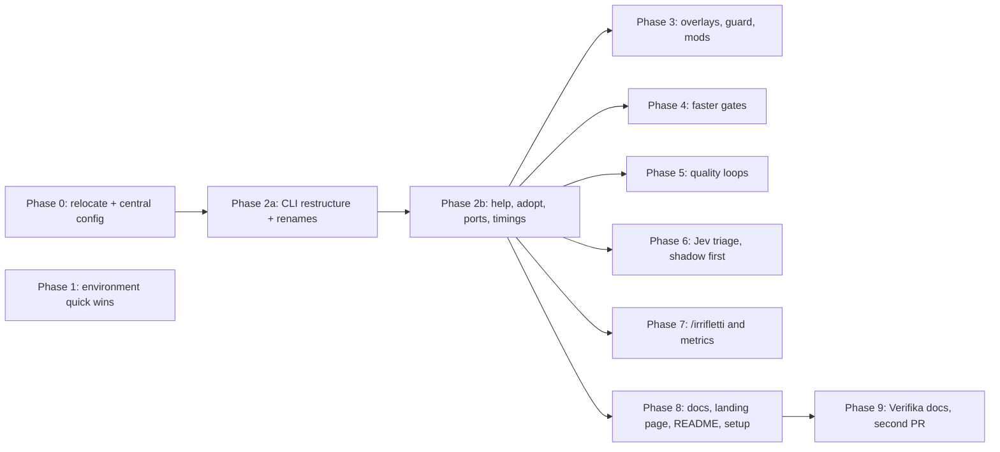

# mexxi upgrade plan

Oct 21, 2026 · @Alex

## Goal and how we'll know

Ten phases, delivered as two PRs (mexxi, then Verifika's docs) with a commit per phase plus a short VPS runbook,, take the harness from "agents fight the environment" to "agents spend their time on the change". The bar is speed **and** quality: every phase either removes a failure the retro measured or adds a check that makes the right thing the easy thing.

Rules that shape every phase, taken from `workflow-for-alex`:

- **Deterministic before prose.** A shell option, a hook or a CLI flag beats a sentence in AGENTS.md. Prose is added only where nothing stronger can own the rule, and an existing line is replaced rather than appended to.
- **Host-neutral core, host-specific adapters.** OpenCode, Claude Code and Codex keep sharing one set of commands, skills and agents. Anything that only one host understands lives in that host's adapter.
- **No gate gets weaker.** Speed comes from removing waste (retries, polling, re-runs, lost context), never from skipping verify, rendered QA or review where they apply.

Success is measured by rerunning the retro two weeks after Phase 3 lands, against the baseline from 90 sessions (26 Sep to 20 Oct):

| Signal | Baseline | Target |
| --- | --- | --- |
| zsh glob aborts | 386 in 77 sessions | near 0 |
| Edit/Write refused before Read | 72 in 31 sessions | under 10 |
| Bash 10-minute cap hits | 28 | 0 |
| Hand-rolled wait loops and sleep blocks | 99 + 24 | under 10 |
| `implementation-workspace` usage errors | about 45 | under 5 |
| Playwright evidence-path errors | 14 in 13 sessions | 0 |
| Compactions mid-PR | 28 in 23 sessions | half |
| Follow-up rework prompts | 15 to 18 in 13 sessions | half |
| Exit status hidden by pipes | 247 runs | 0 (pipefail) |

## Names

Every tool and command is named with a Maltese verb, as a nod to Maltese and to match Verifika. Everything else stays in English: docs, prose, skill names, subcommands and flags. The phases below still use the old English names as working names; Phase 2a does the renames.

| Name | Meaning | Replaces | What it does |
| --- | --- | --- | --- |
| mexxi | steer, lead | `coding-agent-config` | the repository and the workflow as a whole |
| ibni | build | `implementation-workspace` | the worktree CLI: a fresh, isolated worktree per task, through to a published PR |
| /wettaq | carry out | `/implement` | takes a request to a reviewable PR |
| /ittestja | test | `/qa` | hands-on rendered QA; reports, never edits |
| /sewwi | put right | `/update-my-workflow` | audits or changes the workflow itself |
| /fassal | design, sketch out | `/ux.principles` | writes a product's UX principles |
| /irrifletti | reflect | `/retro` | the session retrospective |
| /lesti | get ready | new | opens a PR that makes a repository mexxi-ready, whatever it lacks |
| ibda | begin | `mexxi-setup` | the setup skill a pasted prompt points to: installs or repairs mexxi |

The old names stay as aliases for one release. Skills keep descriptive English names (`rendered-qa`, `commit-pr-writing`), because agents load skills by matching name and description; commands only run when someone types them. Codex's command wrappers change prefix from `workflow-` to `mexxi-`.

## Phase 0 — Move the repo out of \~/.config/opencode

The clone moves to `~/workspace/mexxi`, one file at `~/.config/mexxi/config.json` says where everything lives, and the installer links all three hosts from it. `~/.config/opencode` becomes an ordinary OpenCode config directory that OpenCode keeps reading. Effort: **L**.

**Why it matters now.** Every later phase edits the installer and the paths tools use. Today the checkout *is* `~/.config/opencode`, so the OpenCode links are no-ops. OpenCode's runtime files (the herdr plugin, `tui.jsonc`, `bun.lock`, plugin `node_modules`) land inside the repo and need `.gitignore` entries. Two worktree roots are in use (`~/.local/share/coding-agent/…` and the legacy `opencode/…`), which is also why Playwright couldn't write to evidence directories.

**One config file, no edits to the repo.** Anything a person could reasonably want different lives in `~/.config/mexxi/config.json`, so someone using mexxi changes that file and nothing tracked. A `config.schema.json` in the repo gives every key a default and a description; the installer validates against it, writes a minimal file on first run, and `config.example.json` shows a full one. The test for adding a key: two reasonable users would set it differently. Workflow rules themselves stay in the shared files. This widens Phase 0 to effort **L**.

| Group | What it sets | Default |
| --- | --- | --- |
| `paths` | clone location, worktree root | `~/workspace/mexxi`, `~/.local/share/mexxi/worktrees` |
| `hosts` | which hosts to install for | OpenCode, Claude Code, Codex |
| `models` | model per role and host: explore, UI designer, reviewer (including a cross-family reviewer) | today's choices; unset roles inherit the host's model |
| `workflow` | branch prefix, rendered-QA viewports | `agent/`, 1440 · 768 · 390 px |
| `browser` | Playwright MCP version, browser path, output directory | `0.0.83`, `/usr/bin/chromium`, the worktree root |
| `guard` | deny patterns, protected branches | the Phase 1 starter list, the default branch |
| `jev` | on or off, model, repositories allowed, payload cap | off, `typesafe/jev-1.14`, none, 32 KB |
| `retro` | report folder, transcript retention | `retro/`, 90 days |
| `mods` | which Claude Code mods to install | run pane, command fixer |

**Host files rendered from config.** Today the host adapters (`opencode.json`, the generated agent files) are committed with models and paths baked in. They become templates: the installer renders them from `config.json` into `~/.local/share/mexxi/generated/` and links each host to the rendered copy. Claude Code's `settings.json` belongs to you, so the installer merges only the keys it owns (deny rules, hooks, `env`) and records which they are. `npm run verify` renders with the default config and checks the result, replacing today's stale-file check.

`MEXXI_CONFIG` can point at another file for tests. The old `OPENCODE_WORKTREE_ROOT` variable is retired; the legacy `opencode/…` root stays readable until its last retained workspace is swept, then that code path is deleted.

**How the hosts inherit.** One mechanism for all three: the installer symlinks from `checkout` into each host's home (`~/.config/opencode`, `~/.claude`, `~/.codex` plus `~/.agents/skills`). `OPENCODE_CONFIG_DIR` was considered and rejected: it needs an environment variable in every shell and service, merges on top of the global config instead of replacing it, and would make OpenCode the one host configured differently.

**Keeping it honest.** `install --check` re-renders from the current config and fails on any difference: a host file edited by hand, a mod not read from the current clone, or a Playwright MCP server whose version or output directory doesn't match `config.json`. Drift becomes a red check, not a mystery.

**Code changes in the PR:**

- `scripts/lib/config.mjs`: load, validate and default `config.json`; shared by the installer and the workspace CLI.
- Installer: `--migrate-from <old checkout>` relinks every link that points into the old path (today it would stop on them as conflicts); writes `config.json` on first run; drops the herdr and `tui.jsonc` lines from `.gitignore`.
- Workspace CLI: worktree root from `config.json`.
- Tests for config resolution, migration and the drift checks; README getting-started rewritten around the new path.

**Runbook on atlas** (after the PR merges):

- [ ] In `~/.config/opencode`: clean tree, on `main`, `git worktree list` shows only the main worktree, nothing unpushed
- [ ] `git clone` to `~/workspace/mexxi`, then `npm ci`
- [ ] `mv ~/.config/opencode ~/.config/opencode.pre-move`, create an empty `~/.config/opencode`, copy back runtime-only files (`tui.jsonc`, herdr files, any personal plugins)
- [ ] `node scripts/install.mjs --migrate-from ~/.config/opencode.pre-move`, then `node scripts/install.mjs --check`
- [ ] Start each host: `/implement` and the skills are listed; `ibni list` still shows retained workspaces
- [ ] A week later, delete `~/.config/opencode.pre-move`

**Done when** `install --check` is green on atlas, no tracked file assumes the repo sits in `~/.config/opencode`, and all three hosts load the workflow from the new clone.

## Phase 1 — Environment quick wins

An hour of VPS changes plus one small PR removes the three largest retro counts: silent zsh aborts, hidden exit statuses and the Playwright path clash. Effort: **S**. It can run in parallel with Phase 0.

- [ ] **zsh options.** Add `setopt no_nomatch no_equals pipefail` to `~/.zshrc`. Then, in a fresh Claude Code session, confirm the agent's shell picks them up: an unquoted `grep -rn x --include=*.ts .` must search, and `false | cat; echo $?` must print 1. If Claude Code's shell doesn't load them, the Phase 3 guard hook takes over this job.
- [ ] **Watch `pipefail` for a week.** It turns `cmd | head` into exit 141 when `head` closes early. If agents start chasing those false reds, drop `pipefail` and keep the explicit `EXIT $?` convention instead.
- [ ] **Packages:** `sudo apt install file imagemagick python3-pil bsdextrautils lsof rsync` (adds `column` via `bsdextrautils`). `psql` and `gcloud` only if a project needs them.
- [ ] **Playwright MCP, same args on every host:** pin `@playwright/mcp@0.0.83`, set `--output-dir` to `worktreeRoot`, keep `--headless --isolated`. Do **not** use `--allow-unrestricted-file-access`: it also lets the browser open any `file://` path on the VPS. The installer prints the exact `claude mcp add` and `codex mcp add` lines from `config.json`; `opencode.json` is updated in the PR.
- [ ] **Bash cap:** set `BASH_MAX_TIMEOUT_MS` to 900000 (15 minutes) in `~/.claude/settings.json`, so the slowest repository's p90 verify (about 12.5 minutes) no longer hits the wall. Background runs stay the norm (Phase 3).
- [ ] **Production deny rules:** `permissions.deny` entries for each project's production deploy commands and API hosts, so a denied production call can't be resent piece by piece. Starter list below; add any deploy scripts from repositories it doesn't cover.

Starter deny list for `~/.claude/settings.json`. Prefix rules are easy to sidestep (`cd x && firebase deploy`), so the Phase 3 guard repeats them as patterns and also blocks write calls to the Shopify Admin API (`*.myshopify.com/admin/api`):

```json
{ "permissions": { "deny": [
  "Bash(firebase deploy:*)",
  "Bash(npm run deploy:*)",
  "Bash(npm publish:*)",
  "Bash(gcloud functions deploy:*)",
  "Bash(gcloud run deploy:*)",
  "Bash(vercel --prod:*)",
  "Bash(netlify deploy --prod:*)",
  "Bash(gh pr merge:*)",
  "Bash(gh release create:*)",
  "Bash(git push --force:*)",
  "Bash(git push -f:*)"
] } }
```

**Done when** a fresh session on atlas shows the zsh options active, rendered QA writes straight into `evidenceDir` on all three hosts, and the deny list is in place.

## Phase 2 — The workspace tool becomes a small CLI

`implementation-workspace` is already a 1,600-line CLI in one file, and about 45 retro errors came from its gaps. Two PRs: a pure restructure first, then the features. Effort: **M** each.

**PR 2a — restructure and rename, no behaviour change.** Split into `bin` (argument parsing, help), `commands/` (one module per subcommand) and `lib/` (git, locking, metadata, config). The CLI becomes **`ibni`**, and the commands, the setup skill and Codex's wrappers take their Maltese names from the Names table, all in the same commit. Every old name stays as an alias for one release, so running sessions keep working. The JSON output contract stays identical, and the existing 1,056-line test file must pass with only the command name changed. That is the proof nothing moved.

**PR 2b — features, in retro order:**

| Feature | Fixes | Evidence |
| --- | --- | --- |
| `--help` for the tool and each subcommand, exit 0; `publish-media` usage lists the allowed file types | agents grepping the source to learn flags | about 25 errors in 17 sessions |
| Session commands find the repo from `--session` metadata, from any directory, including `evidenceDir` | `publish-media` failing outside the worktree | 10 errors in 9 sessions |
| `adopt --pr <url>`: a new session takes over a retained workspace after proving branch, head and metadata match | follow-ups pinned to the session that opened the PR | 28 compactions in 23 sessions |
| `prepare` assigns a free `PORT` and records it; `info` returns it | dev servers colliding across parallel worktrees | enables parallel runs |
| Each lifecycle step records start, end and outcome; verify attempts and review/QA finding counts go in metadata; `stats` prints them | retros needing transcript parsing | basis for Phase 7 |
| `git push` retried once on an HTTP 5xx | a transient GitHub error ending a run | 1 session |

`/implement` and `/qa` are updated in the same PR: follow-ups use `adopt` when the session doesn't own the workspace, and rendered QA starts the app on the recorded port.

**Done when** the old test suite passes after 2a, every subcommand answers `--help`, and a fresh session can `adopt` an open PR and deliver a follow-up.

## Phase 3 — Host overlays and shared guardrails

Rules that only one host understands get a host-specific home, and the Git red lines move from prose into one guard script that all three hosts call. Effort: **M**.

**Claude Code overlay.** The installer stops linking `~/.claude/CLAUDE.md` straight to `AGENTS.md`. It links a generated `claude/CLAUDE.md` instead: the shared `AGENTS.md` plus a short Claude-only section. The generator works like the agent adapters, and `npm run verify` rejects a stale copy. Generating avoids depending on how `@imports` resolve through a symlink. The Claude-only section carries three rules from the retro:

- Open a file with the Read tool before Edit or Write, and again after `sed -i`, a formatter or a script touches it (72 refusals).
- Anything that may take more than about 2 minutes runs with `run_in_background`; wait for its completion notification, never a polling loop (99 loops, 28 cap hits).
- Wait for a condition with Monitor, never `sleep` (24 blocks).

Codex and OpenCode get no overlay until a retro shows friction specific to them.

**One guard, three hosts.** `scripts/hooks/guard.mjs` reads the tool call as JSON on stdin and blocks with exit code 2 and a reason. Claude Code and Codex use the same `PreToolUse` input and exit-2 convention, so they call the script directly. OpenCode calls it from a small plugin on `tool.execute.before`. It blocks:

- force pushes, pushes to the default branch, `gh pr merge`;
- `git stash`, `git reset --hard` and `git clean` outside an owned implementation worktree;
- unquoted `--include=*` and `--exclude=*` globs, only if Phase 1 showed the zsh options don't reach the agent's shell.

The matching "never" lines in `AGENTS.md` shrink to one sentence that points at the guard. The installer adds the hook entries and `install --check` verifies them. Codex asks you to trust new hooks once.

**Loop breaker.** A `PostToolUse` hook counts identical failing commands per session. On the third, it tells the agent to stop retrying and re-diagnose. It is deterministic now; Phase 6 may later add a Jev judgement for near-identical retries.

**Completion pings to your phone are deferred.** The run pane's finish signals cover the local case for now.

**Claude Code mods.** Two mods ship in `claude/mods/`. They are Claude Code only, so they make the workflow easier to watch or harder to trip over, while the rules every host follows stay in the shared files and the guard.

- **Run pane:** a panel beside the chat showing the current `/implement` run from the workspace CLI's `info` and `stats`: stage, gates passed (verify, QA, review), worktree, port, PR link and Jev's triage answers.
- **Command fixer:** a `tool.call` hook that rewrites instead of blocking. It quotes unquoted `--include=*` globs, adds `pipefail` to verify pipes, and moves a foreground `npm run verify` or `vfk --all` into the background.
- **Context nudge** (part of the run pane): a band above the prompt once a PR is delivered or context runs high, suggesting a fresh session and `adopt` for follow-ups.
- **Finish signals** (part of the run pane): a toast and a sound when a background verify ends or a PR is published.

Each mod has tests run by `claude plugin test`, and a `mods` Verifika check runs `claude plugin validate` on them.

**Installed by the same installer.** The repo carries `.claude-plugin/marketplace.json` listing the mods by relative path. On first run the installer calls `claude plugin marketplace add <checkout>` and `claude plugin install <mod>@mexxi`, skipping any already installed. Claude Code reads a folder marketplace's plugins from the folder itself, so a `git pull` updates them with no reinstall; open sessions pick up changes with `/reload-plugins`. `install --check` confirms through `claude plugin list` that each mod is read from the current checkout, which also catches mods left pointing at the old `~/.config/opencode` path after the move. Hosts without the `claude` CLI are skipped.

**One prose addition, in `AGENTS.md`:** if a permission check or classifier denies an action, never retry it in pieces, rephrase it or route around it; report what was blocked and why it was needed.

**Done when** the guard blocks a test force-push on all three hosts, the Claude-only rules appear only in the Claude overlay, and a finished `/implement` run shows its stages in the run pane.

## Phase 4 — Faster gates, none weaker

The slowest parts of a run are re-proving what is already proven, waiting on questions nobody is there to answer, and loading instructions a run never uses. Effort: **M**, as one PR to `/implement` plus one to the CLI.

- **Reuse a proven baseline.** If the default-branch commit `prepare` starts from already has a green CI run of the repository's full verify, `prepare` records that run as the baseline instead of rerunning it locally. The match must be on the exact commit, and the repository opts in by naming its CI check. Anything else runs the baseline as today. Same evidence, minutes saved per run.
- **An unattended policy in `/implement`.** When nobody answers (a scheduled run, or a question unanswered for the session), the agent takes the most reasonable reading, records it under **Assumptions** in the PR and carries on. It still stops for a one-way door. Questions become review items instead of stalls.
- **Slim the always-loaded command.** Independent review, remediation and the follow-up path move from `commands/implement.md` into an `implement-review` skill, loaded only when a review runs. The aim is about 150 always-loaded lines instead of 249, with no rule lost: each moved paragraph has exactly one new home.
- **Faster worktree installs.** `/implement`'s dependency step adds `--prefer-offline --no-audit --no-fund` to `npm ci` unless the repository documents its own install. Still one `node_modules` per worktree.
- **A review bundle, only if the numbers ask for it.** If Phase 2's timings show reviewer bookkeeping (OCR preview, rule lookup, per-file diffs) is a real share of review time, add a `review-bundle` subcommand that returns all of it in one call. Otherwise skip it. The retro showed no evidence either way.

Model routing needs nothing new: OpenCode's `explore` already runs on a faster model, Claude Code's built-in Explore does the same, and the reviewer should stay on the strongest model available.

**Done when** a run on a CI-green default branch skips the local baseline with that CI run cited as evidence, and an unattended run delivers a PR with an Assumptions section instead of stalling.

## Phase 5 — Loops that raise quality

These changes make the right outcome the default instead of a follow-up prompt, which is where the 15 to 18 rework rounds came from. Effort: **M** across two PRs.

- **Fix in-scope lows before delivery.** In `/implement`, "low findings are reported, not churned" becomes: a low inside the task's scope with a bounded fix is fixed in the same remediation batch, with no extra review pass; a low that is out of scope or a matter of taste is listed in the PR. The rule lives in `/implement` only, not in `AGENTS.md`. Evidence: deferred lows were the strongest source of rework.
- **A reviewer from a different model family.** The implementer and reviewer currently share blind spots. Each host adapter can name a reviewer model from another family: Claude Code calls the shared `code-reviewer` through `codex exec` in a read-only sandbox, and OpenCode sets the reviewer's model in `opencode.json`. When the other host isn't installed, it falls back to the same model and says so in Evidence. Phase 7 compares the share of findings accepted before and after.
- **A rendered-QA helper and readiness rules.** A script shipped with `rendered-qa` does the three-viewport sweep, names the screenshots, checks for horizontal overflow and reports small touch targets. Agents rebuilt this by hand each session (138 ad-hoc browser scripts, 119 fixed waits, 15 timeouts). The skill gains five rules: wait for a readiness signal, not a timer; confirm no dev-error overlay; take a snapshot before guessing selectors; dismiss overlays that intercept clicks; 5-second action timeouts.
- **QA suggestions become issues.** Rendered QA ends with "could become executable checks". At delivery, the orchestrator files each one as a `qa-check` issue in the app repository, skipping duplicates, so they turn into tests over time instead of vanishing.
- **Preview links in the PR.** When an app repository documents a preview deploy (Firebase Hosting channel, Vercel), `commit-pr-writing` puts its URL in the **Check:** line, so product validation works from your phone.
- **Skill trigger evals.** A small eval set per core skill (`rendered-qa`, `repo-context`, `commit-pr-writing`, `verifika`) proves each loads when it should on all three hosts. It runs through `skill-creator` whenever a skill description changes, as part of `/update-my-workflow`, not in `npm run verify`, because it needs model calls.

**Done when** a test run with a planted in-scope low ships with it fixed, a QA suggestion lands as an issue, and the trigger evals pass on all three hosts.

## Phase 6 — Jev triage, shadow first

Jev takes the "which gates does this change need?" calls out of prose and makes them consistent across Opus, GPT-5.6 Luna and Kimi. It earns trust in three stages and can never remove a gate until the data says so. Effort: **M**.

**The call.** A `triage` subcommand runs after the task contract is set. It sends one batched Jev request with the request text, the contract, changed file paths and diff stats. No source code goes by default. It asks:

| Question | Type | Drives |
| --- | --- | --- |
| Does this change alter UI that already exists? | yes/no | before-shots |
| Is it user-facing? | yes/no | rendered QA |
| Does it touch migrations, data writes, public contracts or deploys? | yes/no | one-way door flag for the reviewer |
| How big is it: mechanical, local, feature, cross-cutting, other? | choice | review depth |
| How much would an independent review add? | score | independent review |

Answers and confidences go into session metadata next to what the agent actually did.

**Three stages:**

1. **Shadow, two weeks.** The agent decides exactly as today; triage only records. Phase 7 compares the two.
2. **Escalate only.** A high-confidence "needs review" or "needs QA" adds that gate even when the agent would have skipped it. Triage can never remove a gate at this stage.
3. **Skip, if earned.** Only if shadow data shows strong agreement and no escaped defects: a high-confidence "mechanical, low review value" may skip the independent review. You set the threshold from the data.

**Through OpenRouter.** The CLI posts to OpenRouter's System One endpoint (`https://openrouter.ai/api/v1/systemone`), authenticated with `OPENROUTER_API_KEY`; no TypeSafe account is needed ([OpenRouter's Jev guide](https://openrouter.ai/docs/guides/community/jev)). The model is pinned to `typesafe/jev-1.14`, not the `~typesafe/jev-latest` alias, so a model release can't shift answers mid-calibration. State is kept under about 32 KB, because larger text requests switch to a long-context mode that TypeSafe says is slower and less accurate. Each answer's `usage.cost` is recorded with it.

**Fails open.** With no key, a timeout or a 429, the run behaves exactly as today. The key stays in the environment, never in the repo. Codex, Claude Code and OpenCode all just call the CLI, so no host needs Jev-specific config.

**Safeguards on what leaves atlas:**

- **Metadata only.** Triage sends the request, the contract, changed paths and diff stats. Never file contents, diffs, logs, environment files or command output.
- **Redacted first.** The retro script's secret patterns run over the payload before it is sent; anything that matches is replaced, and the call is recorded as redacted.
- **Bounded.** The payload is capped below 32 KB and truncated from the least important field; a 5-second timeout and one retry on a 429.
- **A dedicated key with a spend limit.** Jev gets its own OpenRouter key with a low credit limit, so a runaway loop can't drain your main balance.
- **Opt-in per repository.** `config.json` lists the repositories triage may run in. Repositories owned by another organisation are excluded by default, since their content isn't only yours to share.
- **Audited.** Each call's payload size, model, answers and `usage.cost` are written to session metadata, so `/retro` can show exactly what was sent and what it cost.
- **Data policy.** If OpenRouter's account-level data-retention restrictions can be applied to the TypeSafe provider, turn them on; if not, the metadata-only rule is the protection.

**Cost.** Jev bills input tokens only; output is free. TypeSafe's own benchmark put a 13-question batch at $0.0005 and 0.27 s ([parallel questions cookbook](https://docs.typesafe.ai/cookbooks/parallel_questions.md)); OpenRouter's per-token price is on the model page. The win is consistency and an audit trail, not raw speed.

**Later candidates:** the loop breaker's "same failing approach?" judgement, and sorting PR comments into change requests versus questions for `adopt`. Jev stays out of judging code quality, reading screenshots or anything that needs counting, which its docs say belongs in code.

**Done when** triage runs in shadow on every `/implement`, its answers sit in metadata, and Phase 7 can report agreement with the agent's choices.

## Phase 7 — Measurement and a /retro command

Tonight's retro becomes a repeatable command, so each phase is judged against the baseline instead of by feel. Effort: **S**.

- **`/retro` command.** It wraps the extraction script from PR #11, moved to `scripts/retro/`. It reads Claude Code transcripts plus the per-step timings Phase 2 records, and compares against the previous retro.
- **Reports never go to this public repo.** Output lands in a private location named in `config.json` (`retro.output`: by default a gitignored retro/ folder inside the clone, never committed and never read by the docs generator). The script keeps its redaction, and the command refuses to write into a public repository.
- **Keep enough history.** Raise Claude Code's `cleanupPeriodDays` to 90 so a retro can see across several phases.
- **What each run reports:** the baseline signals from the goal table; time from `prepare` to PR; Jev triage agreement (Phase 6); the share of review findings accepted with a same-family vs a cross-family reviewer (Phase 5).
- **When to run it.** On demand, not on a schedule, in line with `workflow-for-alex`. Suggested points: two weeks after Phase 3, and at the end of the Jev shadow period.

**Done when** `/retro` reproduces tonight's numbers from the same transcripts and writes only to the private location.

## Phase 8 — A generated docs site on GitHub Pages

`npm run docs:build` turns the repository's own files into a searchable site, and a GitHub Action publishes it to Pages on every merge to `main`. Nothing is copied by hand, so the docs can't drift from the workflow they describe. Effort: **M**.

**A landing page in Verifika's style.** The site root is a hand-written landing page in `site/`, built the way Verifika's is: static HTML and CSS, no build step, dark theme, the same layout and type, with mexxi's own mark and accent colour. It says what mexxi is in one line, shows the `/implement` flow, lists the three supported hosts and what's in the box, gives the install commands with copy buttons, and links to **Docs** and GitHub. The generated docs are built into `site/docs/`, so one Pages deployment serves both: `alexportelli12.github.io/mexxi/` and `…/mexxi/docs/`.

**A README that makes the case.** The README is rewritten last, after every phase has landed, and is built to land the idea fast:

1. **The problems, stated plainly.** Agents skip tests, never look at the UI, fight their environment, and hand back PRs you have to reverse-engineer. Where it helps, the retro's numbers back this up.
2. **How mexxi solves each one,** a problem at a time: a fresh worktree per task, a green `verify` before and after, rendered QA, an independent reviewer, guardrails the agent can't talk past, and PRs you review in a minute.
3. **Getting started:** write `config.json`, run the installer, try `/implement`.
4. **Links to the docs** for everything else. The details live there, not in the README.

It is direct, follows the `docs-writing` skill, and `docs-fresh` treats both the README and the landing page as hand-written pages with their own `sources`.

**Set up by pasting a prompt.** Adopting mexxi should take one paste into whatever agent someone already uses. Two copyable prompts sit at the top of the landing page, the README and the docs' Getting started page, each with a copy button:

- **Install mexxi:** "Set up mexxi for me. Read https://raw.githubusercontent.com/alexportelli12/mexxi/main/skills/ibda/SKILL.md and follow it."
- **Prepare a repository:** "Make this repository ready for mexxi: run /lesti here."

The `ibda` skill does the work, and it is also installed like every other skill so later runs need no URL:

1. **Checks prerequisites:** Node, git, `gh` signed in, the `ocr` CLI, `ffmpeg` (optional). It says what is missing and how to install it, and installs nothing without asking.
2. **Asks only what it can't detect:** clone location, which hosts to set up (it detects which are installed), models per role, and whether to turn Jev on. Everything else takes the schema defaults.
3. **Installs:** clones, runs `npm ci`, writes and validates `config.json`, runs the installer and then `install --check`, and adds the Playwright MCP server to each host.
4. **Prepares a repository** with the second prompt, which hands off to `/lesti` (below).
5. **Hands over:** suggests a first small `/implement` and links the docs.

It is safe to rerun: on an existing install it upgrades and repairs instead of starting over. It never overwrites existing host configuration; when the installer reports a conflict, the skill explains it and asks. Behind it sits a non-interactive installer path (`install --config <file> --yes`) that verify tests in a throwaway home directory, so the steps the skill relies on are proven on every change.

**`/lesti`: one PR that makes a repository mexxi-ready.** It is for repositories that have never been used with mexxi and may lack anything: no `verify` script, no Verifika, no agent docs, thin tests. Unlike `/wettaq`, it can't demand a green `verify` first, because establishing one is its job. It runs in its own `ibni` worktree and delivers like any other change.

1. **Audit against the mexxi contract** and list every gap, before changing anything:

| Requirement | What `/lesti` checks |
| --- | --- |
| `npm run verify` | exists, uses Verifika, and covers the checks the repository really has (package scripts, CI workflows, tool configs) |
| Tests | a test runner is set up and runs; nothing is invented when there are none |
| Agent docs | a short `AGENTS.md`: how to install, run, test and seed the app |
| Review coverage | `.opencodereview/rule.json` includes the repository's test paths |
| Rendered QA (UI repositories) | a documented dev-server command and port; whether a preview deploy exists |
| Baseline reuse (Phase 4) | which CI check runs the full verify, if any |
| UX principles (UI repositories) | `UX_PRINCIPLES.md` exists; if not, it suggests running `/fassal` afterwards rather than inventing principles |

2. **Fix the gaps** with the smallest change that meets each requirement, following the repository's own conventions. A repository without `package.json` gets a minimal one holding Verifika and the `verify` script.
3. **Prove it:** `npm run verify` passes on the PR branch, and `ibni prepare` followed by `/wettaq` preflight would succeed.
4. **Deliver a PR** that lists each gap, what was added and why, and anything left for a human (product principles, failing checks). The usual review gate applies when the change is substantial.

**When the repository's own checks already fail, `/lesti` fixes them in the same PR.** The gate is complete from day one. To keep that PR reviewable:

- **Two kinds of commit:** setup commits (Verifika, `verify`, agent docs, config) come first; each failing check is fixed in its own commit after them, so the setup reads separately from the code fixes.
- **Fix, never weaken:** a failure is fixed at its cause. Disabling a lint rule, skipping or deleting a test, loosening types or lowering a threshold is not a fix. If a failure can't be fixed without a product decision, `/lesti` stops and asks rather than guessing.
- **Review is mandatory** when the PR contains code fixes, and the description lists every pre-existing failure with how it was fixed.

**A nod to Maltese.** The README, the landing page and the docs explain every name. Each command and tool page opens with its Maltese word, a short pronunciation hint, its literal meaning and what the tool does. A "The names" page (also a short README section) lists them all together, with one line on why: the tools are named in the author's native language, like Verifika. Pronunciation hints are written by Alex, not generated. The Maltese words go into the Vale vocabulary so the prose check accepts them, and the docs generator reads the meanings from one `names.json` file so every page says the same thing.

**Generated from the canonical sources.** `scripts/docs/build.mjs` reads tracked files only and writes pages into a gitignored `docs-site/`:

| Section | Generated from |
| --- | --- |
| Start here | `README.md` |
| Principles | `AGENTS.md`, `skills/workflow-for-alex` |
| Commands | `commands/*.md`, one page each |
| Agents | `agent/*.md`, plus what each host adapter grants (tools, sandbox, model) |
| Skills | each `SKILL.md`, its `description` as the summary, references folded under it |
| CLI reference | each subcommand's `--help` output (Phase 2) |
| Configuration | the `config.json` keys and defaults (Phase 0), and what the installer links for each host |

Only three pages are written by hand: getting started on a new machine, "how a run works" (a Mermaid diagram of `/implement`), and a glossary.

**Built with VitePress.** One dev dependency, Markdown in, and built-in local search with no external service. The build also writes `llms.txt` and a plain `.md` copy of each page, so agents can search the same docs.

**Kept honest by verify.** A `docs` Verifika check, scoped to the source paths, builds the site and fails on a broken internal link or a skill with no `description`.

**Docs stay current by rule, not memory.** Most pages are generated, so they change when their source does. The hand-written pages declare what they describe in frontmatter (`sources: [commands/implement.md, scripts/workspace/**]`). A `docs-fresh` Verifika check fails when a branch changes a listed source but not the page, and names the page to review. The fix is to update the page, or to bump its `reviewed:` date when nothing needs to change. `/update-my-workflow` gains one step: update the affected docs pages in the same change.

**One voice.** A short `docs-writing` skill owns tone for the site and for every Markdown file humans read here. The baseline is how this repo already reads:

- British spelling (behaviour, optimise), as the repo already uses.
- Lead with the outcome; then how. One idea per paragraph, sentences under about 25 words.
- Address the reader as "you"; active voice; plain words over jargon.
- One term per concept, taken from the glossary (a worktree is never also a "workspace folder").
- No marketing adjectives, no filler openers, no restating the heading.

What a tool can check, a tool checks: a `prose` Verifika check runs [Vale](https://vale.sh) with the glossary as its vocabulary and a few house rules (spelling variant, banned filler phrases, preferred terms). The skill covers the judgement Vale can't.

**Deployment.** `.github/workflows/docs.yml` runs on push to `main`: `npm ci`, build, `actions/upload-pages-artifact`, `actions/deploy-pages`. One-time setup: repository Settings → Pages → Source: GitHub Actions.

**Privacy.** The generator reads an allowlist of tracked paths, so retro output, `config.json` and anything machine-local can never reach the public site.

**Done when** the landing page is live at `alexportelli12.github.io/mexxi`, its Docs link opens the generated site, searching a word from any skill's description finds that skill, the README describes the finished tool, the setup prompt takes a clean home directory to a green install --check, and verify fails on a planted broken link.

## Phase 9 — Docs for Verifika, same principles

Verifika gets the same treatment in its own repository and its own PR: a searchable docs site under its existing landing page, generated where it can be, checked by verify, written in the same voice. Effort: **M**.

**What it has today.** A hand-made landing page in `site/` deployed by `.github/workflows/pages.yml` with no build step, five hand-written guides in `docs/` (agents, architecture, benchmarks, CLI, configuration), and a landing-page **Docs** link that points at the GitHub README.

**What changes:**

| Page | Source |
| --- | --- |
| Guides | the five `docs/*.md` files stay hand-written, each with `sources:` frontmatter for `docs-fresh` |
| Configuration reference | generated from `schemas/verifika.schema.json` and its descriptions, so a new option documents itself |
| CLI reference | flags and exit codes generated from the CLI's own definitions; the prose around them stays in `docs/cli.md` |
| Examples | one page per `examples/*.json` |
| Agent skill | `skills/verifika/SKILL.md` |
| Changelog | `CHANGELOG.md` |

- **Built the same way:** VitePress with local search, an `llms.txt`, and output into `site/docs/`. `pages.yml` gains a build step, and its trigger paths add `docs/**`, `schemas/**`, `examples/**` and the CLI source. The landing page's Docs link moves to `/verifika/docs/`.
- **Checked by verify:** `docs` (build and broken links), `docs-fresh` and `prose` (Vale with a Verifika glossary) join `verifika.config.json`, each scoped to its paths.
- **Same voice:** agents working in the repo load the shared `docs-writing` skill from mexxi. The Vale style and the build script are copied, not shared through a package; they get extracted once a third repository needs them.
- **README stays the npm front page:** it is shipped in the package, so it stays concise and gains a link to the docs. `CONTRIBUTING.md` gains the rule that a change updates its docs. The landing page gains the agent setup prompt the README already has, with a copy button.

**Done when** `alexportelli12.github.io/verifika/docs/` is live with working search, a new schema option appears in the configuration reference without anyone writing it, and verify fails when `docs/cli.md`'s sources change without it.


## Sequencing, running it, and your decisions

Phase 0 goes first, then the CLI split, because every later phase either changes the CLI or reads what it records. Phases 3 to 8 build on those two; the docs site comes last so it documents the finished state. Phases 0 to 8 ship as one pull request on mexxi with one commit per phase, and Phase 9 as a second PR on Verifika, both built by a single Claude Code loop (the prompt is at the end of this doc).



**One PR, still reviewable.** A single PR is fine here as long as it reads phase by phase: one commit per phase (so Phase 2a's no-behaviour-change diff can be checked on its own), a per-phase checklist in the description, and one independent review over the whole branch. Three things cannot happen inside the PR and become a post-merge runbook instead: the move on atlas, the VPS changes from Phase 1, and the two-week Jev shadow period.

**Dropped from the earlier list:** the Claude Code permission allowlist. The retro showed the denials were correct, and auto mode handled routine calls without prompting.

**Decisions for you:**

- [x] Repository name: **mexxi** (renamed from `coding-agent-config`), cloned at `~/workspace/mexxi`
- [x] CLI name: **ibni**, with `implementation-workspace` as a one-release alias
- [x] Production deny list: the starter list in Phase 1, plus any other deploy scripts in use
- [ ] Notifications: deferred
- [x] `/retro` reports: a gitignored `retro/` folder in the clone
- [x] Jev: through OpenRouter with `OPENROUTER_API_KEY`, metadata only, with the Phase 6 safeguards

## How this plan is run

One Claude Code loop on atlas implements every phase on this branch, one commit per phase, and delivers it in this pull request. The loop prompt is in the pull request description. This file is removed in the loop's final commit, once the docs site and README carry everything that lasts.
